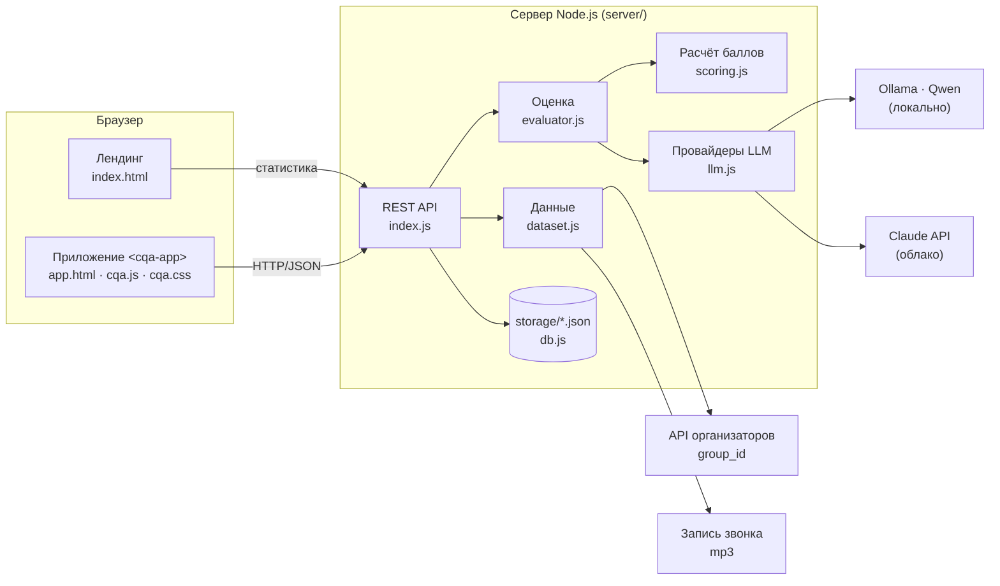
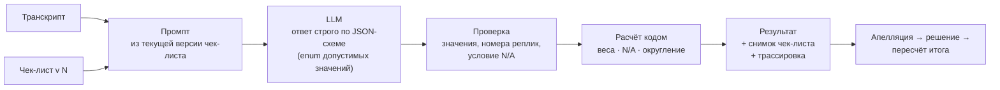

# CQA — архитектура, ТЗ и план

Документ отвечает на три вопроса: **как устроена система**, **что она должна делать** (ТЗ сайта и тестов) и **в каком состоянии работа** (план).

---

## 1. Архитектура

**Принцип разделения.** Браузер только показывает данные и отправляет действия. К модели, к API организаторов и к хранилищу ходит только сервер. Поэтому нет проблем с CORS, ключ модели не попадает в браузер, а компонент `<cqa-app>` можно встроить в Dynamics 365, указав `api-base`.

**Принцип оценки.** Модель только *выбирает ответ* по каждому критерию и указывает реплики. Баллы, перераспределение весов при N/A, округление и итог считает код. Поэтому расчёт воспроизводим и покрыт тестами.

### Режимы оценки

| Режим | Как работает | Когда |
|---|---|---|
| `single` | один вызов: все критерии в одном ответе | сильные облачные модели (Claude) — дешевле |
| `per-criterion` | отдельный короткий вызов на каждый критерий; общий префикс (правила + транскрипт) кэшируется моделью | небольшие локальные модели (Qwen 7B) — меньше путаницы между критериями |

Режим выбирается автоматически по провайдеру; переопределяется `CQA_MODE`.

### Хранилище (`storage/`)

| Файл | Что хранит |
|---|---|
| `conversations.json` | диалоги: id, набор, канал, язык, транскрипт со смещениями времени, ссылка на запись |
| `checklists.json` / `checklist_versions.json` | текущие чек-листы и все их версии |
| `evaluations.json` | оценки: снимок чек-листа, ответы ИИ, финальные ответы, исходный и финальный итог, трассировка, токены, стоимость |
| `appeals.json` | апелляции и решения проверяющего |
| `jobs.json` | очередь пакетной оценки (продолжается после перезапуска) |

---

## 2. Дизайн

**Стилистика — по образцу uniq.com.kz, цвета — Freedom Broker** (по выбору команды): светлый фон, яркий синий, шрифт Geist, крупная плотная типографика с двухцветными заголовками, плавающая шапка-«пилюля», круглые кнопки, радиус 1.2rem, мягкие голубые свечения, бегущая строка, блок «Коротко о главном». Перенесена только стилистика: логотип, иллюстрации, тексты и название uniq не используются, контент и макеты свои.

**Главный макет.** Вместо телефона с приложением — карточка оценки диалога со «всплывающими» пометками: цитата-доказательство, время оценки, принятая апелляция. Это суть продукта: у каждого балла есть реплика-основание.

**Цвета — официальная палитра Freedom Broker** (из CSS fbroker.kz, классы `brand-*`):

| Токен Freedom | Цвет | Роль в CQA |
|---|---|---|
| `brand-primary` | `#00B323` | кнопки, активная вкладка, акценты, логотип CQA |
| `brand-secondary` | `#13AD64` | «пройдено», градиенты, наведение |
| `brand-additional` | `#00E183` | акцент на тёмном фоне |
| `brand-accent` | `#FFA700` | апелляции, предупреждения |
| `brand-tertiary` | `#FF3A38` | нарушения, «Нет» |
| `dark-primary` | `#0C1411` | тёмная тема, тёмные блоки |
| текст / серые | `#0C1411`, `#6A788A`, `#B2BCC8`, `#E7E7EA`, `#F0F2F5` | текст, подписи, линии, фон |
| мягкий зелёный | `#DFF5EC` | подсветка доказательств |

Фирменный шрифт Freedom (CoFo Sans) коммерческий и раздаётся только с их домена, поэтому используется близкий по характеру Geist.

**Типографика:** Geist 400–650, крупные заголовки с плотным трекингом (−0.045…−0.05em), табличные цифры для баллов, размеры в `rem`.

**Проверено:** ширина 1440 и 390 px, светлая и тёмная тема (переключатель в шапке лендинга), примеры расчёта на лендинге совпадают с `computeScore`.

Инструменты: плагин `frontend-design`, `better-design` (типографическая шкала, проверка доступности), скриншоты headless Chrome.

---

## 3. ТЗ: сайт

### 2.1 Лендинг (`/`)
| № | Требование | Статус |
|---|---|---|
| L1 | Первый экран: что делает система, кнопка «Открыть приложение» | ✅ |
| L2 | Живая статистика из API (диалоги, оценено, средний итог, грубые ошибки); без API блок скрыт | ✅ |
| L3 | Разделы «Как работает», «Возможности», «Правила расчёта», «Технологии» | ✅ |
| L4 | Стилистика uniq.com.kz (синий, Geist, шапка-пилюля) без чужих логотипов, иллюстраций и текстов | ✅ |
| L5 | Адаптив до 390 px, светлая/тёмная тема | ✅ |
| L6 | Можно выложить статикой (Vercel); адрес приложения и API — параметрами `?app=&api=` | ✅ |

### 2.2 Приложение (`/app.html`)
| № | Экран / функция (из задания) | Статус |
|---|---|---|
| A1 | Список диалогов: фильтры (набор, язык, канал, поиск), итог, статус | ✅ |
| A2 | Загрузка: API по `group_id`, файл JSON, вставка текста | ✅ |
| A3 | Оценка одного диалога и пакета; прогресс; очередь переживает перезапуск | ✅ |
| A4 | Карточка: транскрипт + результат; по критерию — ответ, баллы, вес, объяснение, реплика-доказательство | ✅ |
| A5 | Для пропущенного действия — проверенный участок; для N/A — причина | ✅ |
| A6 | Итог, секции, отдельная отметка грубой ошибки; перераспределение весов при N/A | ✅ |
| A7 | Ссылка в обосновании ведёт к сообщению; у звонка — перемотка записи | ✅ |
| A8 | Апелляция: критерий, комментарий, предлагаемая оценка | ✅ |
| A9 | Проверяющий: спорная оценка, комментарий, фрагмент диалога; подтвердить/изменить с причиной; пересчёт | ✅ |
| A10 | В карточке видны исходная оценка ИИ, решение и финальный итог | ✅ |
| A11 | Редактор чек-листа: критерии, формулировки, вес, тип, N/A, шкала; версии | ✅ |
| A12 | Новый критерий применяется через настройки без правки кода | ✅ |
| A13 | Трассировка: промпт и ответ модели для каждой оценки | ✅ |
| A14 | Экспорт CSV/JSON | ✅ |

---

## 4. ТЗ: тестирование

Четыре уровня — от быстрых и автоматических к содержательным.

| Уровень | Что проверяет | Как запустить | Модель |
|---|---|---|---|
| **1. Расчёт баллов** | веса, шкалы, N/A, округление, грубая ошибка, нормализация ответов | `pnpm test` | не нужна |
| **2. API** | импорт, оценка, апелляция → решение → пересчёт, версии чек-листа и замена критерия, пакетная оценка, экспорт, ошибки, продолжение очереди после перезапуска | `pnpm test` | заглушка `stub` (только в тестах) |
| **3. Точность на DEV** | совпадение ответов ИИ с экспертной разметкой 26 диалогов (RU 13, KZ 6, EN 5, звонки 2) | `pnpm eval --run --set dev` | реальная |
| **4. Пограничные случаи** | 16 собственных коротких диалогов, по одному на правило чек-листа (RU/KZ/EN) | `pnpm eval --run --set synthetic` | реальная |

### Метрики точности (`pnpm eval`)
- **Совпадение ответов** по каждому критерию и в целом — все и «без спорных».
- **Шкала ±1 ступень** — для шкальных критериев.
- **MAE итога** — средняя ошибка итогового балла относительно эталона, доля в пределах ±5/±10.
- **Грубые ошибки** — найдено / пропущено / ложных.
- **По языкам и наборам.**
- **Список расхождений** с объяснением ИИ — материал для правки «Уточнений для ИИ».

Отчёт: `eval/LATEST.md` (читаемый) и `eval/reports/<время>.json` (история для сравнения).

### Эталон
- `eval/gold/dev.json` — экспертная разметка команды (не эталон организаторов). У каждого диалога по каждому критерию — ответ; спорные критерии (правило допускает два прочтения) помечены и считаются отдельно.
- `eval/gold/synthetic.json` — собственные случаи; размечен только целевой критерий.

### Покрытие пограничных случаев

| Правило | Случаи |
|---|---|
| Контакт: нет имени / чужой язык / только во 2-м сообщении | syn-ru-01, syn-en-02, syn-ru-03 |
| Идентификация: раскрыто до проверки / подтверждено / не требуется | syn-ru-04, syn-kz-05, syn-en-06 |
| N/A: клиент ушёл до запроса | syn-ru-07 |
| Завершение: закрыт без прощания / итог+помощь+прощание | syn-ru-08, syn-en-09, syn-ru-01 |
| Грубая ошибка: частная платная консультация / оскорбление | syn-ru-10, syn-kz-11 |
| Ожидание: без предупреждения / с предупреждением | syn-ru-12, syn-ru-13 |
| Консультация: закрыт один вопрос из двух | syn-en-14 |
| Выявление потребности: переспросил известное / уточнил недостающее | syn-ru-15, syn-kz-16 |

---

## 5. План и статус

| Этап | Статус |
|---|---|
| Контур 1: чек-лист, загрузка, оценка, результат | ✅ |
| Контур 2: карточка, аудио, апелляция, решение, пересчёт | ✅ |
| Локальная модель (Ollama) + облачная (Claude) | ✅ |
| Оформление в стиле Freedom Broker, лендинг | ✅ |
| Редизайн в стилистике uniq.com.kz (лендинг + приложение) | ✅ |
| Сохранение очереди, прогресс после перезагрузки | ✅ |
| Тесты расчёта и API (14) | ✅ |
| Эталонный набор, пограничные случаи, `pnpm eval` | ✅ |
| Факты кодом (контакт, прощание, подтверждение личности), сверка цитат | ✅ |
| Живая оценка по критериям с остановкой | ✅ |
| «Нужна проверка человеком», подтверждение оценки | ✅ |
| Метрики разговора по таймингам | ✅ |
| Обучение на апелляциях → уточнения критерия | ✅ |
| Точность ИИ в «Аналитике», `pnpm check` | ✅ |
| 3D-волна на лендинге (Three.js) | ✅ |
| Сравнение qwen3:8b и qwen2.5:7b, qwen3 по умолчанию (+10 п. на 10 диалогах) | ✅ |
| Перепроверка спорных критериев (опция, по умолчанию выключена — без прироста) | ✅ |
| Публичный репозиторий на GitHub | ⏳ ждёт подтверждения названия |
| Контрольный набор (через 23 ч): `pnpm batch --group <id>` | ⏳ |
| Замена критерия на контроле — через «Чек-листы» → «Сохранить новую версию» → «Оценить все» | ⏳ |
